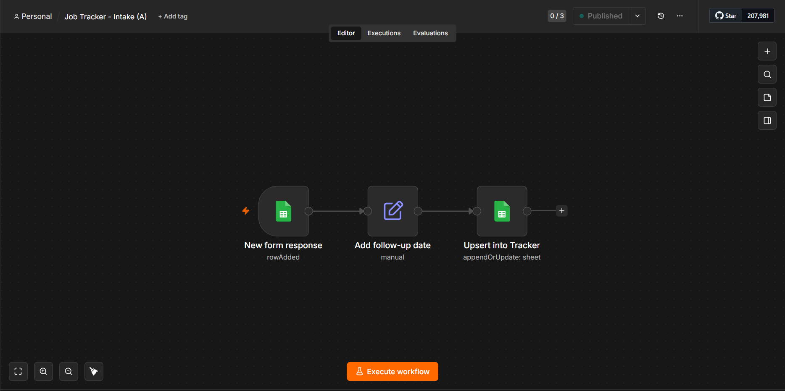
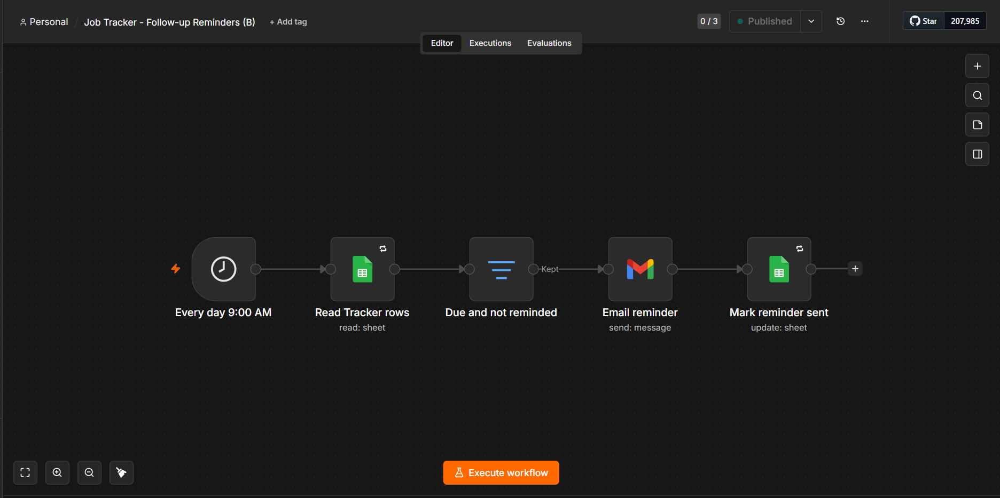
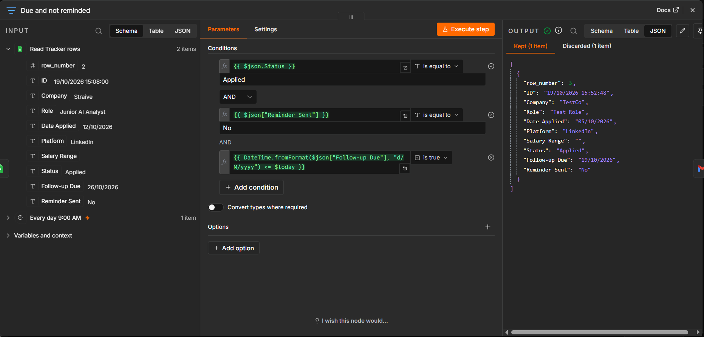
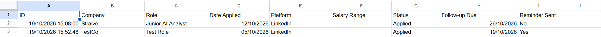
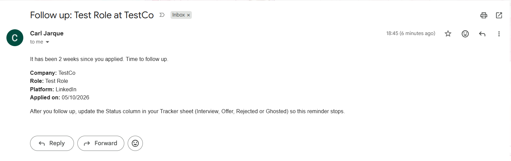
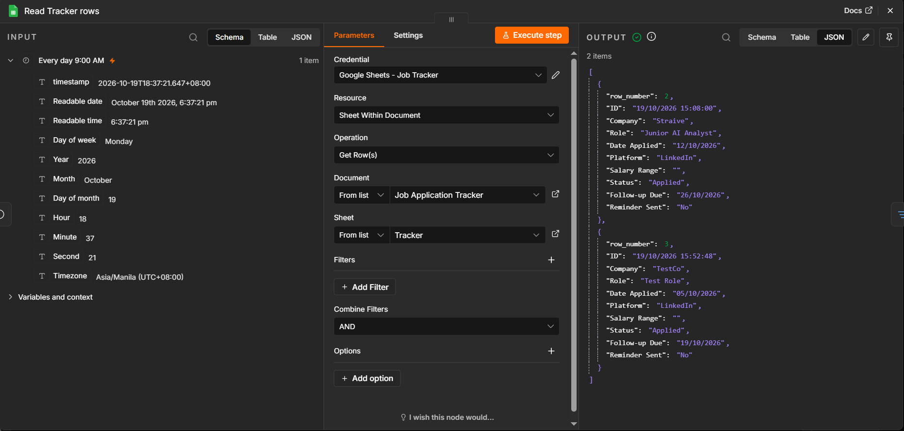

# Job Application Tracker (n8n)

A small personal automation that logs every job application I submit and emails me a follow-up reminder two weeks later, if I haven't updated its status.

**Built with:** n8n (self-hosted), Google Forms, Google Sheets, Gmail

---

## The problem

Applying through several platforms (LinkedIn, JobStreet, Indeed, company sites) scatters applications across tabs and inboxes. The follow-up message that can actually move an application forward is the first thing that gets forgotten. I wanted one place to log each application, and a nudge that arrives without me having to remember it.

## What it does

1. I submit a Google Form: company, role, date applied, platform, salary range, status.
2. Within about a minute, the application appears as a clean row in a **Tracker** sheet, with a follow-up date set 14 days after the date applied.
3. Every morning at 9:00 AM (Manila time), any application that is still `Applied`, is due for follow-up, and has not been reminded yet triggers an email to me.
4. The row is then marked `Reminder Sent = Yes`, so each reminder is sent only once.
5. Changing the Status column (Interview, Offer, Rejected, Ghosted) stops reminders for that row.

## Screenshots

| | |
|---|---|
| **Workflow A: intake** |  |
| **Workflow B: reminders** |  |
| **The filter that decides what is due** |  |
| **The Tracker sheet** |  |
| **The reminder email** |  |
| **How dates arrive from the sheet** |  |

## How it works

```
Google Form
    │
    ▼
Form responses 1 (sheet tab, filled by the form)
    │   polled every minute
    ▼
Workflow A:  New form response → Add follow-up date → Upsert into Tracker
    │
    ▼
Tracker (sheet tab)  ◄── I edit the Status column here
    ▲
    │   read once a day
Workflow B:  Every day 9:00 AM → Read Tracker rows → Due and not reminded
                                      → Email reminder → Mark reminder sent
```

### Tracker columns

| Column | Source |
|---|---|
| ID | Form submission timestamp (unique key) |
| Company, Role, Date Applied, Platform, Salary Range, Status | Copied from the form |
| Follow-up Due | Added by n8n: Date Applied + 14 days |
| Reminder Sent | Added by n8n: starts as `No` |

### Workflow A: intake

| Node | What it does |
|---|---|
| New form response | Google Sheets Trigger, "row added" on the form's response tab, polling every minute |
| Add follow-up date | Edit Fields: maps the form fields, sets `ID`, computes `Follow-up Due`, sets `Reminder Sent = No` |
| Upsert into Tracker | Google Sheets "append or update row", matching on `ID` |

### Workflow B: reminders

| Node | What it does |
|---|---|
| Every day 9:00 AM | Schedule Trigger, timezone set to `Asia/Manila` |
| Read Tracker rows | Reads every row of the Tracker |
| Due and not reminded | Filter: `Status = Applied` AND `Reminder Sent = No` AND `Follow-up Due <= today` |
| Email reminder | Gmail: sends an HTML email with company, role, platform and date applied |
| Mark reminder sent | Updates the row (matched on `ID`) with `Reminder Sent = Yes` |

## Design decisions

- **Two workflows instead of one long "wait 14 days".** A single workflow that waits two weeks cannot re-check the sheet when it wakes up, and it breaks if the instance restarts mid-wait. A daily scan of the sheet handles "has the status changed since?" naturally.
- **The sheet holds all the state.** There is no hidden state inside n8n. The `Status` and `Reminder Sent` columns are what the system reads, and I can fix or override any row by hand.
- **Polling trigger instead of a webhook.** n8n has no native Google Forms trigger. Watching the form's response sheet works on a local instance with no public URL.
- **Upsert on `ID` instead of plain append.** If the trigger ever fires twice for the same submission, the row is updated instead of duplicated.
- **"Due on or before today", not "due exactly today".** If a run is missed (for example, my computer was off at 9 AM), the next run still catches the reminder.
- **Mark as sent only after the email succeeds.** If sending fails, the row stays `No` and tomorrow's run retries it.
- **Retries on the safe steps only.** Reading the sheet and updating a cell are safe to repeat, so they retry on failure. Sending the email does not, because a retry after a lost confirmation could send a duplicate.
- **Timezone set explicitly.** n8n defaulted to US Eastern time, which would have fired a "9 AM" schedule at 9 PM in Manila and skewed "today" in the date comparison.
- **OAuth consent screen published.** In "Testing" status, Google expires sign-ins after about 7 days, which would silently stop the automation.

## Problems I hit, and how I fixed them

| Problem | Cause | Fix |
|---|---|---|
| The Google Sheets Trigger showed "No credentials" | n8n credentials are specific to the node type, and the trigger needs its own | Created a separate trigger credential with the same OAuth client |
| Follow-up dates would have been wrong | The sheet uses day/month/year; the formula assumed month/day | Parsed with the format `d/M/yyyy` |
| Reminders would fire at the wrong hour | n8n's default timezone was US Eastern | Set the workflow timezone to `Asia/Manila` |
| A column was not being filled | Typo in a sheet header (`Reminder Set`) and n8n matches by header text | Corrected the header to `Reminder Sent` |
| Filter output did not change after editing the sheet | The editor replays cached test data from the previous node | Re-ran the read node first, then the filter |
| An email was sent but the row stayed `No` | The update node was set to write `No`, so it succeeded without changing anything | Found by running the full workflow and checking the sheet; set the value to `Yes` |
| "Connection timed out" reading the sheet | A momentary network failure | Turned on retry-on-fail for the read and update nodes |
| Email body ran together in one paragraph | Line breaks were lost in plain-text mode | Switched the email to HTML |
| Could not publish the OAuth app | Google requires a homepage and privacy policy link | Added both on the Branding page, then published |

## Testing

- A real Google Form submission created a row in the Tracker with no manual action (Workflow A, live).
- A row that was due and not yet reminded sent exactly one email and was marked `Yes`.
- Running the workflow again sent nothing.
- A row that was not yet due was correctly skipped.

## Limitations and next steps

- **It only runs while n8n is running.** This is a self-hosted instance on my own machine. Moving it to a small always-on host would remove that dependency.
- **One reminder per application.** A second follow-up after another week is a natural extension.
- **Possible AI step:** an LLM node that drafts a tailored follow-up message from the company and role, included in the reminder email. This is not built yet.

## Setup

1. Create a Google Form with the questions `Company`, `Role`, `Date Applied`, `Platform`, `Salary Range`, `Status`, and link it to a new spreadsheet.
2. In that spreadsheet, add a `Tracker` tab with the headers: `ID, Company, Role, Date Applied, Platform, Salary Range, Status, Follow-up Due, Reminder Sent`.
3. Run n8n locally with `npx n8n`.
4. In Google Cloud, create a project, enable the Google Sheets, Google Drive and Gmail APIs, configure the OAuth consent screen, and create an OAuth client (Web application) using n8n's redirect URL.
5. In n8n, create the Google Sheets, Google Sheets Trigger and Gmail credentials with that client ID and secret.
6. Import the two workflows from `workflows/`, point them at your spreadsheet, and set each workflow's timezone.
7. Adjust the date format string (`d/M/yyyy`) if your sheet uses a different locale.
8. Publish both workflows.

## Repository layout

```
.
├── README.md
├── workflows/
│   ├── job-tracker-intake-a.json
│   └── job-tracker-follow-up-reminders-b.json
└── docs/
    └── screenshots/
```

Credentials are not included in the exported workflow files. Check the JSON before committing anyway.
